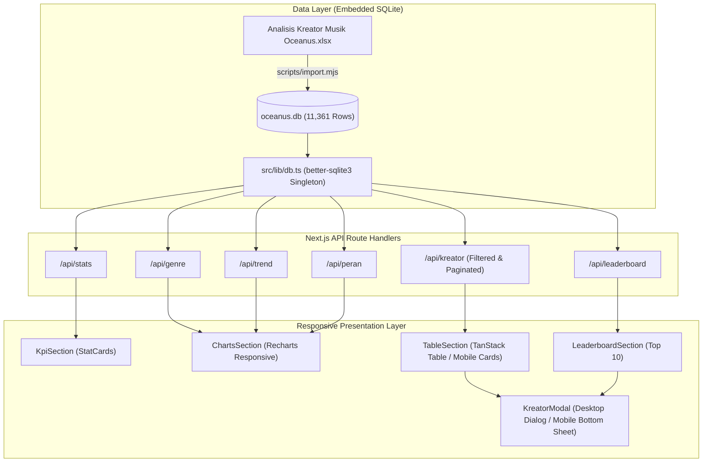
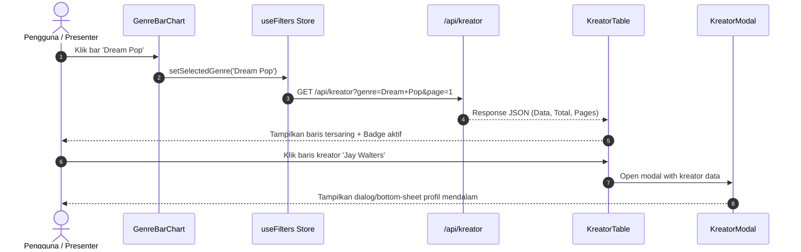

# Technical Design: Dashboard Oceanus

## 1. Arsitektur Sistem



## 2. Skema Database SQLite (DDL)

```sql
CREATE TABLE IF NOT EXISTS kreator (
  id_kreator        INTEGER PRIMARY KEY,
  nama              TEXT NOT NULL,
  nama_panggung     TEXT DEFAULT '',
  n_performer       INTEGER DEFAULT 0,
  n_komposer        INTEGER DEFAULT 0,
  n_lirik           INTEGER DEFAULT 0,
  n_produser        INTEGER DEFAULT 0,
  total_karya       INTEGER DEFAULT 0,
  karya_notable     INTEGER DEFAULT 0,
  n_genre           INTEGER DEFAULT 0,
  genre_utama       TEXT,
  thn_pertama       INTEGER,
  thn_terakhir      INTEGER,
  pengaruh_diterima INTEGER DEFAULT 0,
  karya_dirujuk     INTEGER DEFAULT 0,
  n_grup            INTEGER DEFAULT 0,
  n_peran           INTEGER DEFAULT 0,
  bucket_karya      TEXT
);

-- Indeks performa untuk filter & query analitik
CREATE INDEX IF NOT EXISTS idx_kreator_genre   ON kreator(genre_utama);
CREATE INDEX IF NOT EXISTS idx_kreator_bucket  ON kreator(bucket_karya);
CREATE INDEX IF NOT EXISTS idx_kreator_thn     ON kreator(thn_pertama);
CREATE INDEX IF NOT EXISTS idx_kreator_notable ON kreator(karya_notable DESC);
CREATE INDEX IF NOT EXISTS idx_kreator_karya   ON kreator(total_karya DESC);
CREATE INDEX IF NOT EXISTS idx_kreator_nama    ON kreator(nama COLLATE NOCASE);
```

## 3. Sequence Diagram Interaksi Filter & Detail Modal



## 4. Format Kontrak API
- `/api/stats`: `{ total_kreator, avg_total_karya, genre_terbanyak, genre_terbanyak_count, kreator_elite, thn_range, dekade_puncak }`
- `/api/genre`: Array of `{ genre: string, count: number }` (27 items)
- `/api/trend`: Array of `{ dekade: number, label: string, count: number }`
- `/api/peran`: Array of `{ genre: string, performer: number, komposer: number, lirik: number, produser: number }` (Top 7)
- `/api/leaderboard?by=notable|pengaruh|karya`: Array of top 10 `{ id_kreator, nama, nama_panggung, genre_utama, total_karya, karya_notable, pengaruh_diterima, thn_pertama, thn_terakhir }`
- `/api/kreator`: `{ data: Kreator[], total: number, page: number, limit: number, pages: number }`
