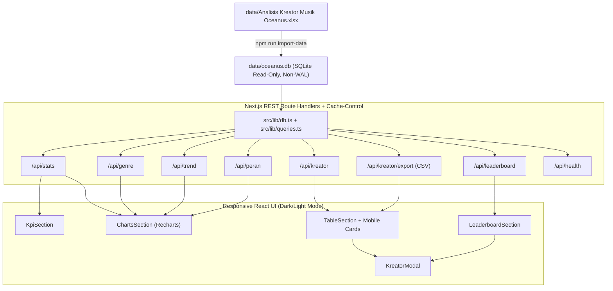

# 🌊 Dashboard Oceanus — Analisis Kreator Musik

> Dashboard Analitik Business Intelligence untuk eksplorasi dan visualisasi 11.361 data kreator musik di dunia *Oceanus* (kurun waktu 1975–2040). Dibangun dengan metodologi **Spec-Driven Development (Kiro)**, arsitektur Next.js 15 (`standalone`), basis data tertanam SQLite read-only, sistem desain visual **"Laut & Suara"** (Dark & Light Mode), dan siap deploy via Docker ke **Render**.

[](https://nextjs.org/)
[](https://react.dev/)
[](https://www.typescriptlang.org/)
[](https://www.sqlite.org/)
[](https://tailwindcss.com/)
[](https://www.docker.com/)

---

## 📑 Daftar Isi
- [Latar Belakang & Insight](#-latar-belakang--insight)
- [Fitur Utama](#-fitur-utama)
- [Arsitektur Sistem](#-arsitektur-sistem)
- [Panduan Instalasi & Menjalankan Lokal](#-panduan-instalasi--menjalankan-lokal)
- [Panduan Deployment ke Render](#-panduan-deployment-ke-render)
- [Pengujian & Validasi](#-pengujian--validasi)
- [Struktur Direktori](#-struktur-direktori)

---

## 🔍 Latar Belakang & Insight

Proyek ini menganalisis dataset `data/Analisis Kreator Musik Oceanus.xlsx` yang memuat **11.361 profil** musisi, komposer, produser, dan penulis lirik di ekosistem *Oceanus*.

### Temuan Analitik Utama:
1. **Dominasi Absolut Dream Pop**: Dari 27 genre unik, Dream Pop memimpin dengan 2.535 kreator (22,3%), diikuti Indie Folk (1.234) dan Doom Metal (1.051).
2. **Karakteristik "One-Hit Wonder"**: Sebanyak 75,3% (8.558 kreator) tercatat merilis 1 karya musik (Bucket `1`), sementara kreator elit dengan 10+ karya hanya berjumlah 65 orang (0,57%).
3. **Ledakan Era Digital 2020-an**: Kurva tren menunjukkan lonjakan eksponensial musisi baru pada dekade 2020-an (6.160 kreator / 54,2%), mencerminkan demokratisasi produksi musik digital di Oceanus.
4. **Spesialisasi Peran Tunggal**: Sebanyak 63,5% (7.221 musisi) menjalankan 1 peran spesifik, sementara hanya 81 musisi yang menguasai keempat peran sekaligus.

---

## 🚀 Fitur Utama

- **Key Performance Indicators (KPIs)**: Kartu metrik total kreator, genre #1, era puncak, dan persentase musisi elit secara dinamis dari SQLite.
- **4 Visualisasi Interaktif (Dark & Light Mode)**:
  - *Distribusi Genre Teratas (Top 12 Bar)* — klik bar langsung memfilter katalog.
  - *Tren Kreator per Dekade (Area Chart)* — kurva pertumbuhan 1970s–2030s.
  - *Komposisi Rata-Rata Peran Musik (Stacked Bar)* — performer, komposer, lirik, produser pada top 7 genre.
  - *Segmentasi Produktivitas Karya (Donut Chart)* — dinamis dari database, klik irisan untuk filter bucket.
- **Panggung Kehormatan (Top 10 Leaderboard)**: Pengalih kriteria ranking (*Karya Notable*, *Dampak Pengaruh*, *Total Karya*) dengan profil detail lengkap saat diklik.
- **Eksplorasi Katalog Server-Side & Export CSV**:
  - Pencarian nama/nama panggung instan (debounced 300ms, aman dari wildcard SQL).
  - Dropdown filter lengkap untuk **semua 27 genre**, **Bucket Karya**, dan **Variasi Peran (`0–4` peran)**.
  - Penyortiran kolom bolak-balik dengan indikator arah (`↑`/`↓`), pilihan `20/50/100` baris per halaman.
  - **Sinkronisasi URL Query Params** agar filter tahan refresh & link bisa langsung dibagikan.
  - **Export CSV** untuk mengunduh seluruh hasil filter aktif (UTF-8 BOM, rapi saat dibuka di Microsoft Excel).
- **Modal Profil Responsif**: Dialog di desktop & bottom sheet di mobile yang menampilkan metrik, distribusi kontribusi peran, dan metadata aktif.
- **Dark & Light Mode Persisten**: Preferensi tema tersimpan di `localStorage` dengan kontras warna WCAG AA.

---

## 🏛️ Arsitektur Sistem



---

## 🛠️ Panduan Instalasi & Menjalankan Lokal

### Prasyarat
- Node.js versi **20** atau **22** (atau `24.x` untuk lokal)
- npm

### Langkah Menjalankan:
```bash
# 1. Clone repositori
git clone https://github.com/Rea1kah2/dashboard-oceanus.git
cd dashboard-oceanus

# 2. Pasang dependensi
npm install

# 3. (Opsional) Bangun ulang SQLite dari Excel
npm run import-data

# 4. Jalankan server pengembangan
npm run dev

# 5. Buka http://localhost:3000
```

---

## ☁️ Panduan Deployment ke Render

Repositori ini sudah dilengkapi **`Dockerfile`** (multi-stage `node:22-slim`, mode Next.js `standalone`) dan **`render.yaml`** (Render Blueprint, region `singapore`, health check `/api/health`).

### Opsi 1 — Deploy 1-Klik via Render Blueprint (Disarankan)
1. Push perubahan terbaru ke repositori GitHub Anda.
2. Buka [Render Dashboard](https://dashboard.render.com/) → klik **New +** → pilih **Blueprint**.
3. Hubungkan repositori `dashboard-oceanus` — Render otomatis membaca `render.yaml`.
4. Klik **Apply** dan tunggu proses Docker build selesai (~2–4 menit).

### Opsi 2 — Deploy Manual Web Service (Docker)
1. Buka Render Dashboard → **New +** → **Web Service** → pilih repo `dashboard-oceanus`.
2. Pastikan **Language / Runtime** = `Docker`, **Region** = `Singapore`, **Instance Type** = `Free`.
3. Isi **Health Check Path** = `/api/health`, lalu klik **Deploy Web Service**.

> **Catatan Free Tier Render**: Layanan gratis otomatis *sleep* setelah 15 menit tanpa trafik (cold start 30–60 detik saat pertama dibuka kembali). Karena database `data/oceanus.db` bersifat read-only dan tertanam di Docker image, seluruh 11.361 data selalu aman dan utuh setiap kali container menyala kembali.

---

## ✅ Pengujian & Validasi

```bash
# Validasi TypeScript
npx tsc --noEmit

# Validasi ESLint
npm run lint

# Build produksi standalone
npm run build

# Jalankan automated test suite (integritas SQLite + seluruh endpoint API + Export CSV)
npm test
```

---

## 📁 Struktur Direktori

```
dashboard-oceanus/
├── .kiro/                      # Steering & spesifikasi Spec-Driven Development
├── data/
│   ├── Analisis Kreator Musik Oceanus.xlsx
│   └── oceanus.db              # SQLite read-only non-WAL terindeks
├── public/
│   └── robots.txt
├── scripts/
│   └── import.mjs              # ETL Excel -> SQLite portable
├── src/
│   ├── app/
│   │   ├── api/                # stats, genre, trend, peran, leaderboard, kreator, export, health
│   │   ├── globals.css         # Design tokens Dark & Light Mode
│   │   ├── icon.svg            # Custom SVG favicon Oceanus
│   │   ├── layout.tsx          # Fonts, anti-FOUC theme script, OG metadata
│   │   └── page.tsx            # Halaman dashboard utama
│   ├── components/             # charts, layout, modal, sections, table, ui
│   ├── hooks/                  # useFilters (URL sync) & useDebounce
│   └── lib/                    # db.ts, queries.ts, types.ts
├── tests/
│   └── api-and-db.test.mjs     # Automated DB & API test suite
├── Dockerfile                  # Multi-stage Docker build (node:22-slim)
├── .dockerignore
├── render.yaml                 # Blueprint Render (Singapore, /api/health)
├── next.config.ts              # standalone, tracing, security headers
└── package.json
```
