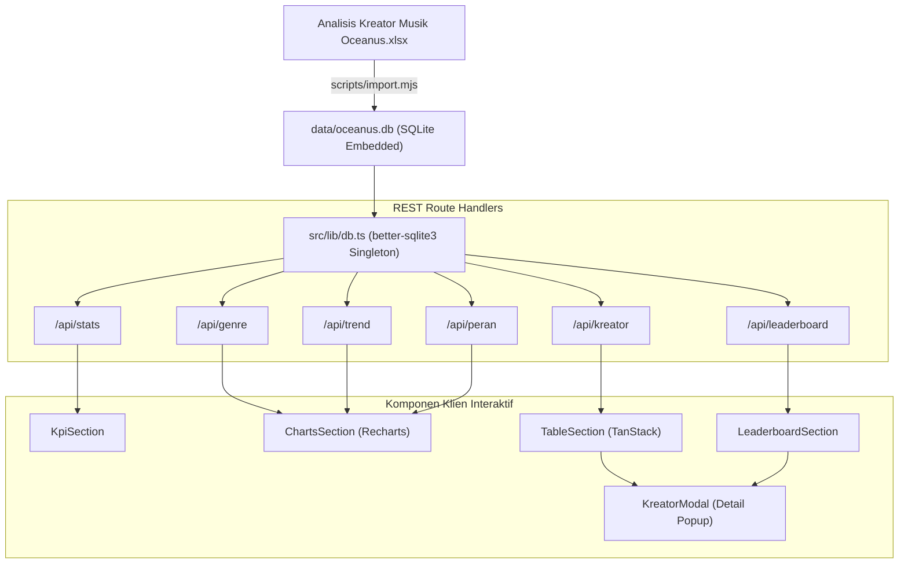

# 🌊 Dashboard Oceanus — Analisis Kreator Musik

> Dashboard Analitik Business Intelligence untuk eksplorasi dan visualisasi 11.361 data kreator musik di dunia *Oceanus* (kurun waktu 1975–2040). Dibangun dengan metodologi **Spec-Driven Development (Kiro)**, arsitektur Next.js 15, basis data tertanam SQLite, dan sistem desain visual **"Laut & Suara"** (*deep ocean theme*).

[](https://nextjs.org/)
[](https://react.dev/)
[](https://www.typescriptlang.org/)
[](https://www.sqlite.org/)
[](https://tailwindcss.com/)

---

## 📑 Daftar Isi
- [Latar Belakang & Insight](#-latar-belakang--insight)
- [Fitur Utama](#-fitur-utama)
- [Arsitektur Sistem](#-arsitektur-sistem)
- [Sistem Desain Visual](#-sistem-desain-visual)
- [Panduan Instalasi & Menjalankan Lokal](#-panduan-instalasi--menjalankan-lokal)
- [Struktur Direktori](#-struktur-direktori)
- [Metodologi Spec-Driven (Kiro)](#-metodologi-spec-driven-kiro)

---

## 🔍 Latar Belakang & Insight

Proyek ini dikembangkan sebagai pemenuhan tugas mata kuliah **Business Intelligence (Semester 5)** dengan menganalisis dataset `Analisis Kreator Musik Oceanus.xlsx` yang memuat 11.361 catatan profil musisi, komposer, produser, dan penulis lirik.

### Temuan Analitik Utama:
1. **Dominasi Absolut Dream Pop**: Dari 27 genre unik, Dream Pop memimpin dengan 2.535 kreator (22,3%), diikuti Indie Folk (1.234) dan Doom Metal (1.051).
2. **Karakteristik "One-Hit Wonder"**: Sebanyak 75,3% (8.558 kreator) tercatat hanya merilis 1 karya musik (Bucket `1`), sementara kreator elit dengan 10+ karya hanya berjumlah 65 orang (0,57%).
3. **Ledakan Era Digital 2020-an**: Kurva tren menunjukkan lonjakan eksponensial musisi baru pada dekade 2020-an (6.160 kreator), mencerminkan era demokratisasi produksi musik digital di Oceanus.
4. **Spesialisasi Peran Tunggal**: Sebanyak 63,5% musisi hanya menjalankan 1 peran spesifik (antara performer, komposer, lirik, atau produser).

---

## 🚀 Fitur Utama

- **Key Performance Indicators (KPIs)**: Kartu metrik total kreator, genre #1, era puncak, dan persentase musisi elit.
- **Distribusi Genre Interaktif**: Grafik batang horizontal 12 genre terpopuler. Mengklik salah satu bar otomatis memicu filter instan ke seluruh tabel katalog.
- **Tren Kreator per Dekade**: Area chart kurva gelombang yang memperlihatkan dinamika pertumbuhan musisi dari 1970-an hingga 2030-an.
- **Komposisi Peran Musik**: Grafik batang bertumpuk (stacked bar) yang menguraikan rata-rata peran (performer, komposer, lirik, produser) pada top 7 genre.
- **Segmentasi Donut Produktivitas**: Visualisasi proporsi pembagian bucket karya (`1`, `2-3`, `4-9`, `10+`, `0`).
- **Panggung Kehormatan (Top 10 Leaderboard)**: Tabel musisi paling berpengaruh dengan pengalih kriteria ranking (*Karya Notable*, *Dampak Pengaruh*, *Total Karya*).
- **Katalog Terfilter & Terpaginasi**: Pencarian nama instan (debounced 300ms), penyortiran kolom bolak-balik, badge filter aktif dengan tombol reset cepat.
- **Modal Popup & Bottom Sheet Responsif**: Mengklik kreator membuka jendela profil mendalam yang memperlihatkan persentase kontribusi peran, riwayat tahun aktif, dan total sitasi musik.
- **Adaptif Seluler (Mobile-First)**: Tabel katalog secara otomatis beralih menjadi daftar kartu yang nyaman disentuh di perangkat seluler (< 640px).

---

## 🏛️ Arsitektur Sistem



---

## 🎨 Sistem Desain Visual

Mengadopsi tema **"Laut & Suara"** (*Deep Ocean & Analogue Resonance*):
- **Palet Samudra**:
  - Background Utama: `#060E1B` (Ocean 950)
  - Card & Surface: `#0A1628` (Ocean 900) & `#0F2240` (Ocean 800)
  - Interactive Accent: `#38BDF8` (Bioluminescent Cyan)
  - Text: `#E2EAF2` (Primary Text) & `#E8D5B0` (Pale Sand Serif Accent)
- **Tipografi**:
  - *Hero & Display Numbers*: **DM Serif Display**
  - *UI Body*: **Inter**
  - *Data & Metrics*: **JetBrains Mono**

---

## 🛠️ Panduan Instalasi & Menjalankan Lokal

### Prasyarat
- Node.js versi 18+ (disarankan Node.js 20 atau 22/24)
- npm atau pnpm

### Langkah Menjalankan:
```bash
# 1. Clone repositori
git clone https://github.com/Rea1kah2/dashboard-oceanus.git
cd dashboard-oceanus

# 2. Pasang dependensi
npm install

# 3. Jalankan migrasi data (Excel -> SQLite)
npm run import-data
# Output: "✅ Berhasil mengimpor 11361 baris ke SQLite dalam ~400ms!"

# 4. Jalankan server pengembangan
npm run dev

# 5. Buka peramban di http://localhost:3000
```

### Menjalankan Build Produksi:
```bash
npm run build
npm start
```

---

## 📁 Struktur Direktori

```
dashboard-oceanus/
├── .kiro/
│   ├── steering/               # Pedoman permanen produk & arsitektur
│   │   ├── product.md
│   │   ├── tech.md
│   │   └── structure.md
│   └── specs/dashboard/        # Spesifikasi fitur Kiro-style
│       ├── requirements.md     # EARS syntax & kriteria penerimaan
│       ├── design.md           # DDL, ERD, sequence diagram
│       └── tasks.md            # Checklist implementasi atomik
├── data/
│   ├── Analisis Kreator Musik Oceanus.xlsx  # Dataset sumber asli
│   └── oceanus.db                          # Database SQLite terindeks
├── scripts/
│   └── import.mjs              # Script ETL migrasi data otomatis
├── src/
│   ├── app/
│   │   ├── layout.tsx          # Konfigurasi font & metadata
│   │   ├── page.tsx            # Halaman orkestrasi dashboard utama
│   │   ├── globals.css         # Design tokens & utilitas CSS
│   │   └── api/                # Handlers endpoint data
│   │       ├── stats/route.ts
│   │       ├── genre/route.ts
│   │       ├── trend/route.ts
│   │       ├── peran/route.ts
│   │       ├── leaderboard/route.ts
│   │       └── kreator/route.ts
│   ├── components/
│   │   ├── layout/             # Navbar & FilterBar
│   │   ├── sections/           # KpiSection, ChartsSection, Leaderboard, TableSection
│   │   ├── charts/             # Recharts components (Bar, Area, Donut, Stacked)
│   │   ├── table/              # KreatorTable & KreatorCard
│   │   ├── modal/              # KreatorModal detail popup
│   │   └── ui/                 # StatCard, Badge, Spinner, EmptyState
│   ├── hooks/                  # useFilters & useDebounce
│   └── lib/                    # db.ts (SQLite) & types.ts (TypeScript interfaces)
├── RENCANA.md                  # Dokumen rencana awal komprehensif
└── package.json
```

---

## 🎯 Metodologi Spec-Driven (Kiro)

Pengembangan dashboard ini menerapkan metodologi **Spec-Driven Development**:
1. **Fase 0 (Steering)**: Mengunci visi produk, personas, batasan teknologi, dan layout folder di `.kiro/steering/`.
2. **Fase 1 (Requirements)**: Menyusun kebutuhan fungsional dengan sintaks EARS (*Ubiquitous, Event-driven, State-driven*).
3. **Fase 2 (Design)**: Memetakan skema database relasional SQLite, indeks query, dan diagram alur Mermaid.
4. **Fase 3 (Tasks)**: Menyusun daftar tugas atomik yang terstruktur di `.kiro/specs/dashboard/tasks.md`.
5. **Fase 4 (Execution)**: Menulis kode dan melakukan verifikasi bertahap.

---

Dikembangkan untuk mata kuliah Business Intelligence • 2026.
